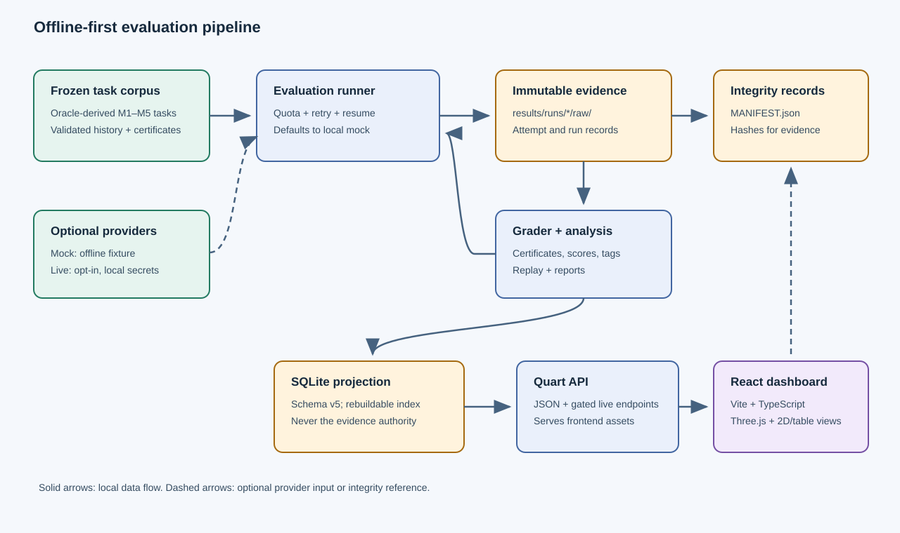

# Architecture

The evaluation is organized around immutable, locally auditable evidence. The
task files and raw attempt records are the source evidence; the manifest
records hashes. Grading and reports are generated from saved attempts. SQLite
is a rebuildable projection for dashboard queries, not the authority for
evaluation results.

The Python `evalkit` package provides the M1–M5 domain/task logic and CLI. The
provider interface defaults to a deterministic local mock; optional
OpenAI-compatible providers are isolated behind explicit CLI selection and
local environment configuration. Expected task answers are produced by the
checker implementations.

Quart serves the JSON API and the built frontend. The React/TypeScript
dashboard uses the API, with Three.js as an optional visualization enhancement.
Map information also has 2D and table presentations. The browser does not need
provider credentials or external CDN assets.

The SQLite projection uses schema version 5. Migrations live in
`backend/db/migrations/`; `python -m evalkit ingest` verifies evidence and
rebuilds the projection when its manifest changes.

## Main data flow

1. Frozen task files are validated and checked with their relevant oracle paths.
2. The runner obtains responses from the selected provider and writes immutable
   raw attempts.
3. The grader verifies the verdict and certificate, then writes grades and
   failure tags.
4. Manifests and verification commands establish file integrity; reports
   summarize saved evidence.
5. Ingest projects verified task/run data into SQLite for the API and
   dashboard.

The default workflow is offline and does not make model calls. Live providers
must be deliberately selected and may incur cost.
